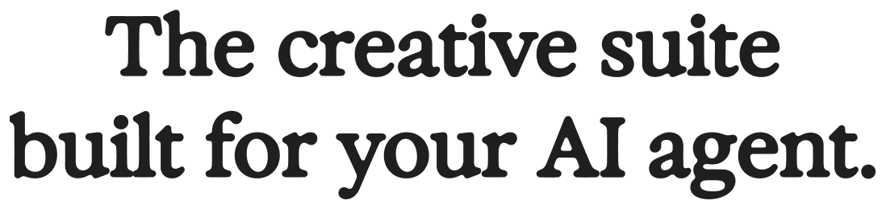
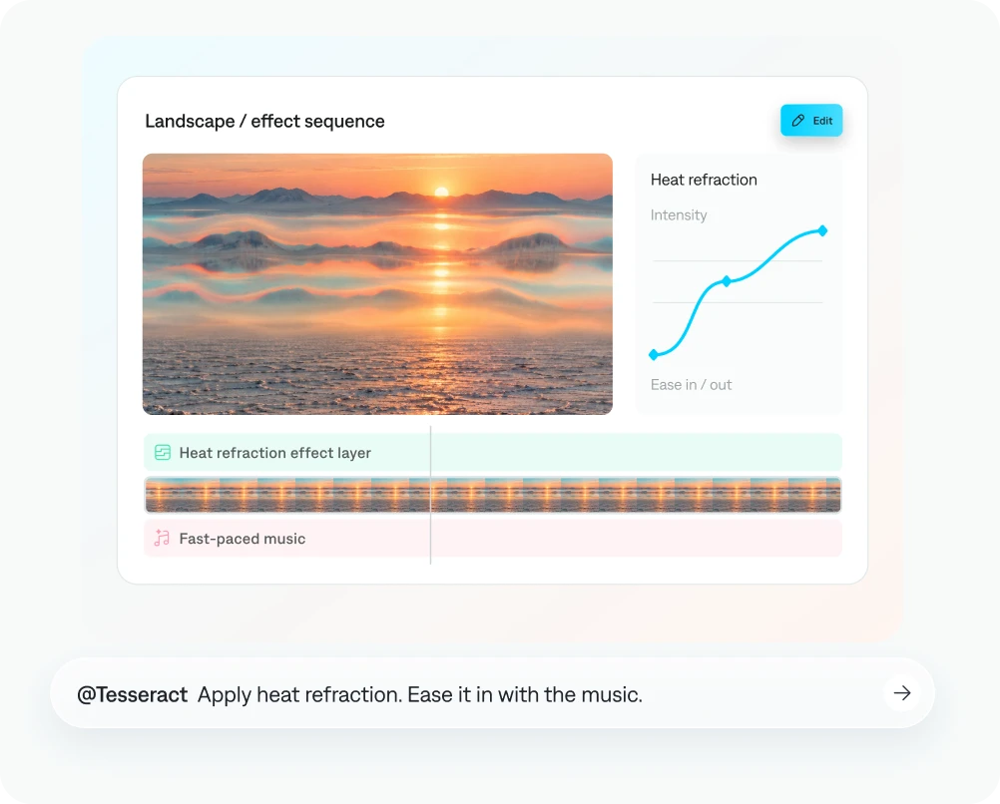
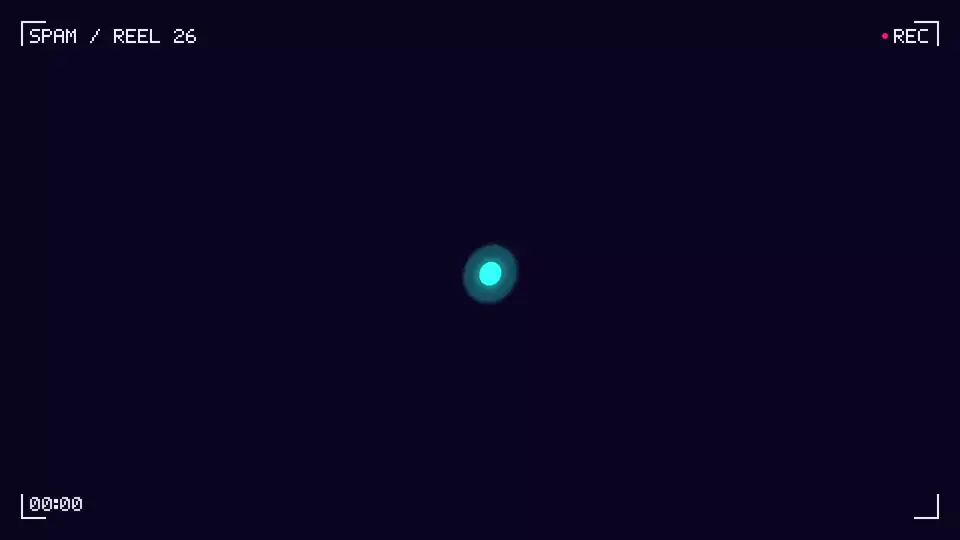
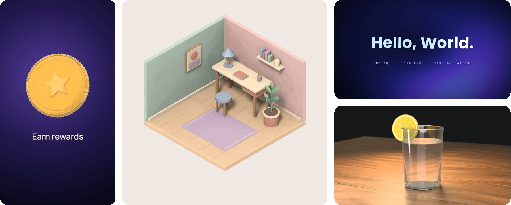

<p align="center">
  <picture>
    <source media="(prefers-color-scheme: dark)" srcset="docs/images/wordmark-dark.svg" />
    <source media="(prefers-color-scheme: light)" srcset="docs/images/wordmark-light.svg" />
    
  </picture>
</p>

<p align="center">
  <picture>
    <source media="(prefers-color-scheme: dark)" srcset="docs/images/headline-dark.png" />
    
  </picture>
  <br />
  Editing, motion, and sound. Connected in one local project.
</p>

<p align="center">
  <picture></picture>
  <picture></picture>
  <picture></picture>
</p>

<p align="center">
  <a href="#made-with-tesseract">Examples</a> ·
  <a href="#install">Install</a> ·
  <a href="#how-it-works">How it works</a> ·
  <a href="#try-a-prompt">Prompts</a> ·
  <a href="#skills">Skills</a> ·
  <a href="#community">Community</a>
</p>

<p align="center">
  <a href="https://mirage.app/tesseract">
    <picture>
      <source media="(prefers-color-scheme: dark)" srcset="docs/images/hero-dark.webp" />
      
    </picture>
  </a>
</p>

## Made with Tesseract

<a href="https://github.com/mirage-hq/Tesseract-Projects"></a>

<sub>**Spam Showreel** · 16:9 · A 15-second brand reel cut to music, with seven scenes and 3D camera moves.</sub>

<a href="https://github.com/mirage-hq/Tesseract-Projects">
  <picture>
    <source media="(max-width: 600px)" srcset="docs/images/examples-formats-mobile.png" />
    
  </picture>
</a>

<sub>**9:16** Coin reveal for social media · **1:1** Isometric room in 3D · **16:9** Animated title card · **16:9** Photoreal glass of water</sub>

Each example comes with its video and its `.tsrct` project file.<br />
[Browse the examples →](https://github.com/mirage-hq/Tesseract-Projects)

<br />

## Install

### ChatGPT Plugin (recommended)

<a href="https://chatgpt.com/plugins/plugin_asdk_app_6ae1c48fd1048191ad1dddcf5e188fb8">
  <picture>
    <source media="(prefers-color-scheme: dark)" srcset="docs/images/button-add-to-chatgpt-dark.svg" />
    
  </picture>
</a>

The plugin adds the skills to **ChatGPT** and **keeps them up to date automatically**.<br />
The plugin also includes an **MCP**, which you can optionally sign in to for additional features.

### Claude Plugin

Coming soon. For now, use the steps in [Any other agent](#any-other-agent).

### Any other agent

For **Claude Code**, **Cursor**, and other agents. Paste this into a new chat:

```text
Install the latest Tesseract skills from https://github.com/mirage-hq/Tesseract and finish any setup they need.
```

These skills don't update on their own. **To get the latest version, paste the prompt again.**

<details>
<summary>Use a terminal command instead</summary>
<br />

```sh
npx skills add mirage-hq/Tesseract
```

Needs Node.js.

</details>

<details>
<summary>Download the CLI manually</summary>
<br />

| Your computer | Download |
| --- | --- |
| Apple Silicon Mac | `darwin-arm64` |
| Intel Mac | `darwin-x86_64` |
| Windows (64-bit) | `windows-x86_64` |
| Linux or cloud agent | `linux-x86_64` |

Get them from [Releases](https://github.com/mirage-hq/Tesseract/releases) and follow the [installation guide](skills/tesseract-video/references/installation.md). Each ZIP has a matching `.sha256` file to verify it.

</details>

<br />

## How it works

Tesseract has two parts:

| Part | What it does |
| --- | --- |
| **Skills** | Teach your agent how to edit video, motion graphics, and 3D. |
| **CLI** (`tsrct`) | Agent uses it to create, edit, and render the video. |

1. You describe the video.
2. Optionally, you attach your clips, music, or logo.
3. Your agent reads the skills for how to edit, animate, and design.
4. Your agent uses the CLI to build an editable project (`.tsrct`).
5. Your agent uses the CLI to view and iterate on the project.
6. You ask for changes, and your agent updates the same project.

<br />

## Try a prompt

You can start your prompt with:

- `@Tesseract` (only works with the **ChatGPT Plugin**)
- "Use Tesseract"
- `/` and a skill name, such as `/tesseract-video`

**Turn your footage into a travel vlog**

```text
[Attach your footage]
/tesseract-video turn my travel footage into a 30-second vlog with beat-synced music.
```

**Create an animated diagram**

```text
@Tesseract animate a diagram of how an order ships:
Order placed → Packed → Out for delivery → Delivered.
Navy #1D2B53 background, coral #FF6B5E accents.
8 seconds, 16:9.
```

**Make a 3D coin flip animation**

```text
Use Tesseract to make a 3D gold coin flip over a purple gradient.
Fade in "Earn rewards" underneath.
Vertical, 3 seconds, for social media.
```

**Design a thumbnail for your video**

```text
[Attach your video]
/tesseract-design make a thumbnail for this video.
Match its fonts and colors.
```

**Iterate on an existing project**

```text
Update /path/to/file.tsrct: make the title arrive earlier and soften the motion.
```

**Build a custom editor for your project**

```text
/tesseract-editor build an editor for this project so I can change the background and text colors.
```

<br />

## Skills

| Skill | What it does |
| --- | --- |
| **Edit Video** | Cuts footage, reframes shots, and mixes dialogue, music, and sound effects. |
| **Motion Graphics** | Animates titles, lower thirds, diagrams, and captions. |
| **3D Scenes** | Builds animated 3D scenes with cameras, lights, and materials. Imports Blender and glTF. |
| **Design** | Makes posters, thumbnails, and social graphics you can keep editing. |
| **Editor** | Builds a browser editor so your team can tweak projects by hand. |

Your agent picks the skill from your request. They all share one `.tsrct` project, so a single video can mix footage, motion, and 3D.

<br />

## Community

Share what you make in [r/TesseractByMirage](https://www.reddit.com/r/TesseractByMirage/). Report bugs in [Issues](https://github.com/mirage-hq/Tesseract/issues).

<br />

## Terms

[Product terms](TERMS.md) · [Tesseract terms](https://mirage.app/legal/tesseract-terms) · [API/MCP terms](https://mirage.app/legal/api) · [Privacy policy](https://mirage.app/legal/privacy-policy) · [Third-party notices](THIRD_PARTY_NOTICES.md)

Each CLI download includes third-party notices, licenses, and matching dependency sources.
